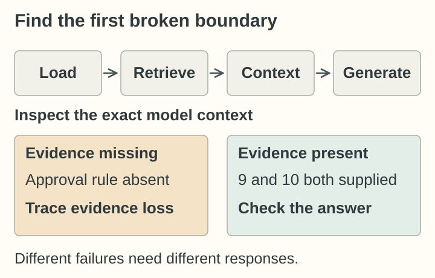
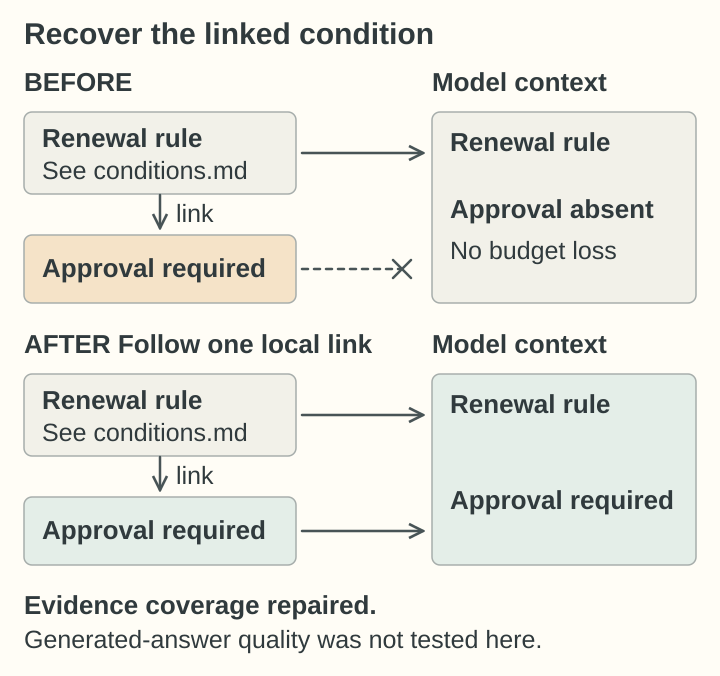
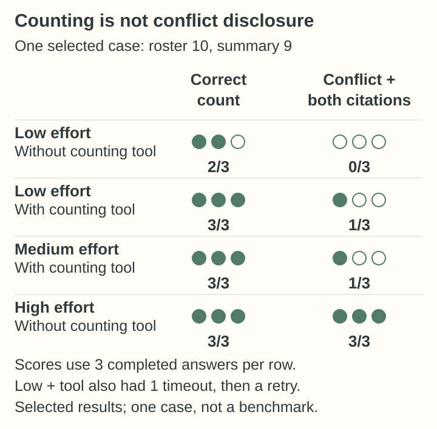

# RAG, told through the questions

[Portfolio](../../README.md) · [Code and offline examples](code/README.md) · [Recorded answers and checks](code/evidence/README.md)

## At a glance

**Question:** when a retrieval-augmented answer goes wrong, which stage owns the failure, and what fixes that stage rather than hiding the failure?

**My contribution:** the questions. I chose to learn on the smallest system I could inspect, asked for failures before explanations, judged which failures were architectural and which were contrivances, proposed the sub-question and contiguity ideas that led to parent-document retrieval, asked for clearer separation between the pipeline stages, ran a find-minimise-classify loop until each stage had a failure, and stated and tested a hypothesis about the counting failure. Agents wrote the code, named the standard techniques and ran every model call.

**Result:** parent-document retrieval kept a rule's conflicting notices together, and following one local link restored a condition that shared no words with the question. In a separate generation experiment, a deterministic counting tool fixed the count but did not make the model report a conflicting source; higher reasoning without the tool did, in three of three runs. These are small exploratory comparisons on a synthetic corpus, not a benchmark.

**How this is written:** the questions below are quoted as I typed them to the coding agent, in order, from the development session logs. Each is followed by what its answer changed.

I wanted to learn how retrieval-augmented generation works by building the smallest version that could fail in instructive ways: a document-answering system for a fictional workshop, in plain Python, with no framework, no vector database and a lexical search I could read.

An agent built the starter: four Markdown documents, word-overlap retrieval, a character budget for the prompt, and a contract saying answers must cite their claims, keep conditions attached, abstain without support, and report disagreements between sources. The model under test was a cheap, fast one (called Luna below), chosen so that failures would be easy to find. The agents wrote the code and ran every model call. The questions below are mine, quoted as I typed them, typos included.

## Failures before explanations

> adversarilly find a question for which the model gives a wrong answer, don't diagnose the reason why it fails

"Don't diagnose" was deliberate: I wanted the failure in front of me before anyone, agent or me, started explaining it. The agent found one with an ordinary question about laser-cutter rules and sander inspection. The handbook has two sander notices, weekly and monthly, which conflict. Retrieval's three passages went to two laser paragraphs and the weekly notice. The monthly one never reached the model, and the answer confidently said "weekly".

## Is that actually wrong?

> well it seems like the example failed by overloading the context selection limit. within the deliberately restricted bounds of this project, it is not obvious to me that this is necessarily "wrong", in the sense of a deficient architecture

The model, given those three passages, answered them faithfully. The system, answering from the handbook, missed a conflict the contract required it to report. Both descriptions are true, and they point at different things to fix.

> well since this is a learning project, and i am aware that increasing top_k would solve this specific issue, but it would be very easy to simply come up with (admittedly contrived) examples to overload even a higher limit, i'm not sure that is what we should do here

A passage limit bounds quantity; the question decides how much evidence is needed. Raising the limit would move the boundary without teaching anything about it. I had another idea, and a doubt about it:

> ah wait. that also gives me an idea. but i'm not sure if we should go beyond the architecture to accommodate it: the example failed by conjuncting more than one question. we could perhaps apply top_k per atomic question instead of per question. the problem i see is that identifying conjuctive questions itself requires model invocation to not be brittle

Split by hand into four sub-questions, the same total passage count recovered both notices. The whole question still missed the monthly notice even at a limit of five, because incidental words such as "member" and "workshop" lifted an unrelated paragraph above it.

## Keep the exception with the rule

> actually another reading is that retrieval should preserve nearby exceptions. i'm thinking we could reuse the scoring to measure similarity of adjacent chunks, and context selection should strive to preserve contiguity of chunks. but i'm also curious as to whether there is a general RAG best practice here

There is: the unit you search need not be the unit you give the model. Search small passages, then supply their enclosing section or document, which the field calls parent-document retrieval.

> how do we know one expansion is enough?

We do not. A fixed radius bounds cost and says nothing about completeness; a structural boundary such as the whole file has a reason behind it, if the file really does group a rule with its exceptions. For four short documents, whole-file expansion was the honest choice, and the prompt now carried both notices. Then:

> does parent document retrieval not belong to the retrieval stage? rag.py retrieve still only gives the first notice

Expansion had been put in context selection, so the retrieval command still showed one notice while the prompt had two. If a stage's output misreports what it did, you can no longer tell which stage failed. So I asked for a clearer separation between the stages: context selection became a module of its own beside retrieval and generation, each inspectable on its own.

## One failure per stage

The pipeline has four stages: loading turns the documents into passages, retrieval ranks the passages against the question, context selection decides which of them fit in the prompt, and generation is the model answering from that prompt.

*Inspect the exact prompt first: evidence that never reached the model and evidence the model failed to use are different failures with different fixes.*

With one failure understood, I wanted a collection of small ones:

> find another failing example, and minimise it, don't diagnose
>
> ok this wasn't the kind of failing example i was looking for. but let's classify this and find another one not belonging to this class of failure

The loop ran through one evening and turned up an alias gap, unindexed headings, a prompt one character over budget, and a question ending "Reply exactly Yes/No" that overrode the citation instruction. One I misread. A borrowing rule said renewals were "subject to conditions" and linked to a second file holding the condition, which shared no words with the question and never reached the prompt.

> well this one is due to a cross file dependency. i'm not sure if there is anything to be done here short of stronger document semantics concerning references

The agent pointed out that the link was a Markdown link: the structure was already there, and the pipeline was treating it as text. Retrieval now follows local links for one hop. That repairs this gap and says nothing about dependencies that are not written as links.

*Following one local link brought the approval condition into the prompt. This checked evidence coverage, not the generated answer.*

> do we now have at least one failure for each of the RAG stages?

Not for generation. Every failure so far was evidence that never reached the model, or an instruction conflict; none was the model misusing evidence it had. So the next specimen was built for that.

## The model had everything and still left something out

The agent built a roster of 16 members, of whom exactly 10 met both requirements to operate the laser, and a separate summary saying 9. Both reached the prompt; the contract required the disagreement to be reported with both citations. At low reasoning, Luna answered 10, cited the roster, and said nothing about the 9.

I had a hypothesis, and I was fairly confident in it:

> hmm it seems to me this is due to the model not doing enough chain of thought reasoning, due to the low reasoning setting, in order to both perform the count AND identify the source disagreement. tool use was disabled right? so it couldn't write a script to perform the calculation. i think if it could have it would have gotten it right. it does seem reasonable to me to provide limited tool use in this case since it involves such counting. alternatively, i'm sure increasing the reasoning level would also solve the problem

Half of it held: at high reasoning, three runs out of three counted correctly, disclosed the conflict and cited both sources. To test the other half, I asked for a counting tool at low reasoning:

> ok do it. keep the tooling as simple as possible (while not making it contrived and non-general) so that luna doesn't get overly confused

One tool counted rows in the table already in the prompt, under column filters the model chose: no code execution, at most two calls. Instructed to use it, Luna chose the right filters every time.

*Three completed answers per row; the low-reasoning rows come from the same alternating-call batch. Selected results from one case; the [recorded answers](code/evidence/README.md) keep every comparison.*

Offloading the arithmetic worked. It did not make the model reconcile its sources. On these few runs they look like different jobs, and my hypothesis had bundled them. The default stayed at high reasoning with no tool, and three runs per condition rank nothing with confidence.

## What I did and did not do

Mine: learning on the smallest inspectable system, with lexical retrieval so each boundary stayed visible. The weakest model setting. Failures before explanations. The judgment of which failures were architectural and which were contrivances. The sub-question and contiguity ideas, and the questions that led from them to parent-document retrieval. The find-minimise-classify loop and the demand for one failure per stage. The counting hypothesis, its test, and the retraction of half of it.

The agents': the starter and every later module; the names and standard forms of parent-document retrieval and link following; the generated and minimised examples; the counting tool's design; every model call and record. I did not write the code or run the experiments myself.

## Inspect the evidence

- [Code companion](code/README.md): the linked-condition and conflicting-count examples, runnable offline with no credentials or model calls, including the pre-fix retriever that reproduces the omission.
- [Recorded answers and checks](code/evidence/README.md): every recorded attempt in the counting experiment, with the manual assessments the scores are computed from, including comparisons not shown above.
- [Retrieval](code/retrieval.py), [context selection](code/context_selection.py), [counting tool](code/count_tool.py) and [generation](code/generation.py).

The companion contains only those two examples. The sander-notice case, the other specimens and the private development history are not included.
